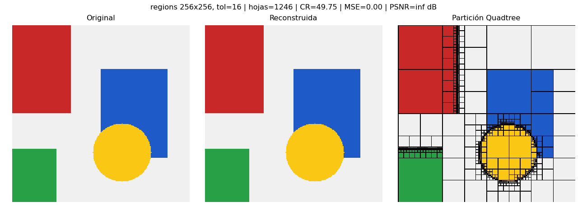
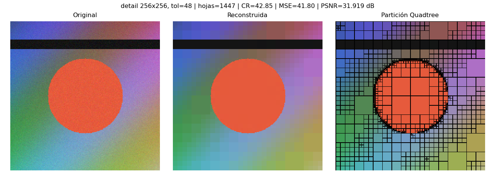
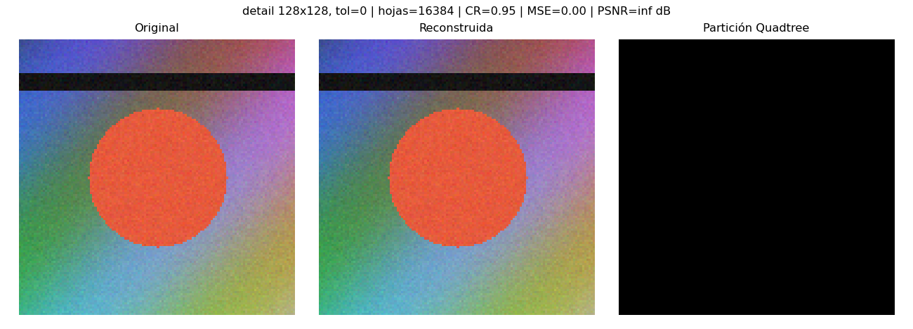

# Evidencias de funcionamiento

## Ejemplo 1: `regions` 256x256, tol=16

| Métrica | Valor |
|---|---|
| height | 256 |
| width | 256 |
| tol | 16 |
| criterion | range |
| nodes | 1661 |
| leaves | 1246 |
| max_depth | 8 |
| build_ms | 23.221 |
| storage_bytes | 3952 |
| original_bytes | 196608 |
| compression_ratio | 49.7537 |
| space_saving_pct | 97.99 |
| mse | 0.0 |
| psnr_db | inf |
| max_abs_error | 0 |

## Ejemplo 2: `detail` 256x256, tol=48

| Métrica | Valor |
|---|---|
| height | 256 |
| width | 256 |
| tol | 48 |
| criterion | range |
| nodes | 1929 |
| leaves | 1447 |
| max_depth | 8 |
| build_ms | 30.199 |
| storage_bytes | 4589 |
| original_bytes | 196608 |
| compression_ratio | 42.8515 |
| space_saving_pct | 97.67 |
| mse | 41.8033 |
| psnr_db | 31.919 |
| max_abs_error | 30 |

## Ejemplo 3: `detail` 128x128, tol=0

| Métrica | Valor |
|---|---|
| height | 128 |
| width | 128 |
| tol | 0 |
| criterion | range |
| nodes | 21845 |
| leaves | 16384 |
| max_depth | 7 |
| build_ms | 206.365 |
| storage_bytes | 51889 |
| original_bytes | 49152 |
| compression_ratio | 0.9473 |
| space_saving_pct | -5.57 |
| mse | 0.0 |
| psnr_db | inf |
| max_abs_error | 0 |
